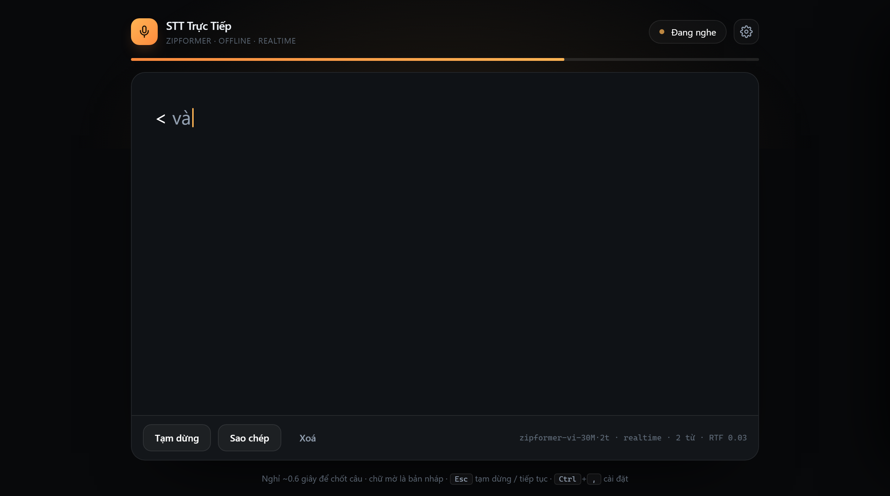
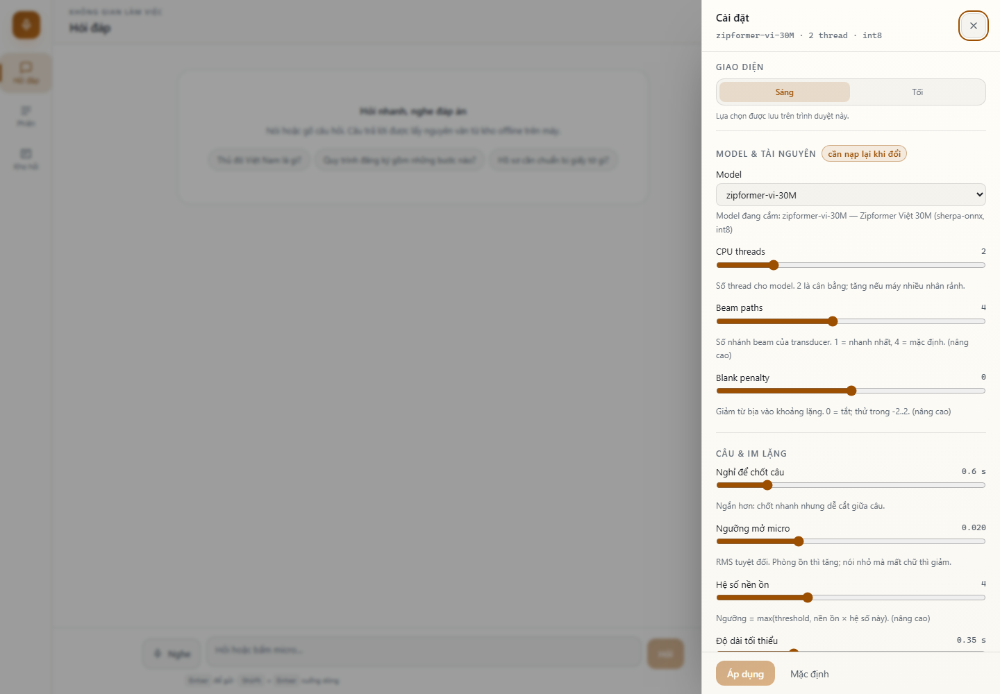

# STT Trực Tiếp

[](https://www.python.org/)
[](https://fastapi.tiangolo.com/)
[](https://react.dev/)
[](https://tailwindcss.com/)
[](https://nodejs.org/)
[](#)
[](#)

**Nhận dạng tiếng Việt offline, realtime trên CPU** — không cần GPU, không cần internet
sau khi cài. Lõi là **zipformer 30M int8 (sherpa-onnx)**, backend **FastAPI**, giao diện
**React + Tailwind**, kèm cơ chế **plugin để cắm model AI khác**. Tính năng **đọc văn bản
(TTS)** dùng **VieNeu-TTS v3 Turbo** chạy offline, xuất WAV 48 kHz.

<p align="center">
  
</p>

<p align="center">
  <em>168 giây audio bản tin → text trong 8.3 giây (RTF 0.049) · khớp 99% bản đối chiếu · không hallucination</em>
</p>

---

## Mục lục

- [Tính năng](#tính-năng)
- [Yêu cầu](#yêu-cầu)
- [Cài đặt nhanh](#cài-đặt-nhanh)
- [Sử dụng](#sử-dụng)
- [Hỏi đáp theo đề cương](#hỏi-đáp-theo-đề-cương)
- [Giao diện](#giao-diện)
- [Kiến trúc](#kiến-trúc)
- [Cấu hình](#cấu-hình)
- [API](#api)
- [Thêm model AI mới](#thêm-model-ai-mới)
- [Hiệu năng](#hiệu-năng)
- [Kiểm thử](#kiểm-thử)
- [Khắc phục sự cố](#khắc-phục-sự-cố)
- [Đóng góp](#đóng-góp)
- [Giấy phép](#giấy-phép)

## Tính năng

- **Hai chế độ nhận dạng**
  - `accurate` — chốt từng câu khi bạn ngừng nói ~0.6s (chất lượng cao nhất).
  - `realtime` — chữ chạy dần theo từng từ, phần chưa chắc chắn hiển thị mờ.
- **Thu âm không rơi frame** — PortAudio callback + tự fallback sang burst; UI hiển thị
  `fr/s`, `coverage`, `dropped` để kiểm chứng (đo được 99–100%, trước đây chỉ 67%).
- **VAD chống khoá** — noise-floor chỉ học từ frame yên tĩnh, ngưỡng bị chặn bởi 30% đỉnh
  gần đây, hysteresis khi đang nói, giữ trạng thái qua pause/resume.
- **Cài đặt dạng drawer** — mở bằng bánh răng hoặc `Ctrl+,`: engine, VAD, preset và
  cảnh báo cấu hình. Chế độ nhận dạng và giọng đọc nằm ở sidebar Hỏi đáp.
- **Đọc câu trả lời (TTS)** — nút **Đọc** trên mỗi đáp án dùng VieNeu-TTS v3 Turbo:
  25 giọng preset, gộp cả giọng clone của app VieNeu, tải WAV 48 kHz; chạy offline
  trên CPU (ONNX), model nạp lần đầu khi dùng. Văn bản được cắt sẵn theo
  `. ! ? … ; : ()` và đoạn văn để chèn khoảng nghỉ đúng chỗ; dấu phẩy giữ trong câu
  cho model đọc tự nhiên. Chọn giọng ở **sidebar Hỏi đáp → Giọng đọc**: có ô nội
  dung thử, nút **Test giọng** và thanh **Tốc độ đọc** 0.8–2.0× (bước 0.2, áp
  dụng ở lần bấm đọc kế tiếp); đổi giọng tự nạp giọng vào RAM ở nền.
- **Hỏi đáp theo đề cương — không dùng LLM** — câu hỏi (nói hoặc gõ) được embed bằng
  `multilingual-e5-small` (ONNX, 384 chiều), so cosine với câu hỏi trong kho rồi
  rerank bằng BM25; câu trả lời là **nguyên văn đáp án** của câu hỏi khớp nhất.
  Kho nạp từ `cauhoi_dapan.docx` (nút **Nhập câu hỏi** ở trang Kho câu hỏi, hoặc CLI).
- **API + docs tự động** tại `/api/docs`, sự kiện realtime qua **SSE**.
- **Plugin model** — thêm model mới bằng một file, không sửa code lõi.

## Yêu cầu

| Thành phần | Phiên bản | Ghi chú |
| --- | --- | --- |
| Python | 3.11+ | đã test 3.13.5 trên Windows 11 |
| Node.js | 18+ | chỉ cần khi sửa giao diện (`npm run dev/build`) |
| Micro | bất kỳ | cần quyền micro của desktop app |
| GPU | không cần | model chạy CPU int8 |

Repo đã kèm sẵn **model zipformer** (`models/sherpa/`). Bản build giao diện
(`frontend/dist/`) không commit vào git: chạy `cd frontend && npm install && npm run build`
một lần trước khi `python run.py`.

TTS dùng package `vieneu` (đã nằm trong `requirements.txt`) và model **VieNeu-TTS v3 Turbo**
trong `models/vieneu/`. Nếu thư mục này chưa có, lần đọc đầu tiên backend sẽ tải model từ
Hugging Face (cần mạng); các lần sau chạy offline.

Linux/macOS cần PortAudio (`sudo apt install libportaudio2` hoặc `brew install portaudio`).

## Cài đặt nhanh

```powershell
git clone https://github.com/vuhung-97/speech_to_text.git
cd speech_to_text

python -m venv .venv
.venv\Scripts\activate          # Linux/macOS: source .venv/bin/activate
pip install -r requirements.txt

python run.py
```

Trình duyệt tự mở `http://127.0.0.1:8765/` (cổng bận sẽ tự nhảy sang cổng kế tiếp).
`Ctrl+C` ở terminal để dừng.

### Phát triển giao diện

```bash
python run.py --no-browser        # terminal 1
cd frontend
npm install
npm run dev                       # terminal 2 → http://127.0.0.1:5173
```

Vite proxy `/api` và `/events` về backend. Khi sửa UI xong, build lại để backend phục vụ:

```bash
cd frontend && npm run build
```

### Tham số dòng lệnh

```bash
python run.py --list-devices
python run.py --mode accurate --cpu-threads 2
python run.py --device 1 --silence-hang 0.5 --threshold 0.008
python run.py --port 9000 --no-browser
```

## Sử dụng

1. Nói tiếng Việt; nghỉ ~0.6s để chốt câu.
2. Ở chế độ `realtime`, chữ mờ là bản nháp đang chờ xác nhận (LocalAgreement).
3. Mở cài đặt bằng nút ⚙ hoặc `Ctrl+,`; đổi `mode`/`threshold` áp dụng ngay, đổi
   `model`/`cpu_threads`/micro sẽ nạp lại nền (UI không bị chặn).
4. Tab **Thử nghiệm trên file**: thả file audio vào `samples/` rồi **Chạy thử** để so
   cấu hình trên cùng một file.
5. Nút **Đọc** cạnh “Sao chép” mở drawer TTS: chọn giọng, dùng transcript hoặc nhập
   văn bản, bấm **Tạo giọng đọc** rồi nghe/tải WAV. Lần đầu nạp model ~10–20 giây.

| Phím | Tác dụng |
| --- | --- |
| `Esc` | Tạm dừng / tiếp tục (đóng drawer nếu đang mở) |
| `Ctrl` + `,` | Mở / đóng cài đặt |

## Hỏi đáp theo đề cương

Luồng chạy (offline, **không có model sinh văn bản**):

```text
micro → STT → text người dùng nói
      → focus_question()                      # bỏ «đồng chí hãy/trình bày/…», «là gì»
      → embedding e5 (384d) → cosine với mọi câu hỏi trong kho
      → BM25 rerank top-10                    # phân biệt «trạm chính» / «trạm vùng»
      → đáp án nguyên văn của câu khớp nhất   # < 0.86: báo chưa có đáp án + 3 gợi ý
```

Điểm hiển thị là **cosine** (0.86 là sàn trả lời, 0.88 là mức "chắc chắn"); BM25 chỉ
đổi thứ hạng nên không làm câu lạc đề vượt sàn. Mã câu (`Câu I.1.1`) chỉ lưu để nhập
lại không nhân đôi — màn hình Hỏi đáp không hiện mã câu.

### Nạp đề cương `.docx`

Mỗi câu trong tệp gồm một dòng `Câu …` (vd `Câu I.1.1`) rồi một bảng 2 cột: hàng đầu
là câu hỏi + điểm, hàng `Đáp án`, các hàng sau là đoạn đáp án + điểm. Parser dùng
`zipfile`/XML của Python (không cần `python-docx`), bỏ cột điểm và tự chịu được ô gộp,
bảng lồng trong content control, câu hỏi nằm cùng dòng `Câu 3: …`, hoặc tệp không có
bảng (đáp án viết thành đoạn).

```bash
python tools/import_docx.py --file cauhoi_dapan.docx          # nạp + embedding ngay
python tools/import_docx.py --file cauhoi_dapan.docx --dry-run # chỉ đếm câu
```

Hoặc mở **Kho câu hỏi → Nhập câu hỏi** và chọn tệp `.docx` (tối đa 20 MB). Mỗi tệp
thành một **bộ đề** (bảng `faq_documents`): nạp lại tệp cùng tên sẽ cập nhật bộ đó,
nạp lại đúng nội dung dưới tên khác thì bỏ qua, còn tệp mới nội dung mới thành bộ
mới. Câu không còn trong tệp (so theo mã câu) bị **tắt** (`active=0`) và được báo ở
mục `stale` — bấm Bật trong danh sách để khôi phục. Trang **Kho câu hỏi** có panel
Bộ đề (đổi tên, xoá cả bộ), màn hình **Hỏi đáp** có dropdown để hỏi trong một bộ
hoặc tất cả. Hai câu gần giống nhau trong đề cương (vd `I.1.7` và `I.1.8`) **không**
bị gộp.

Đo chất lượng tìm kiếm trên bộ câu hỏi vàng (`tools/eval/docx_queries.json`):

```bash
python tools/eval_matcher.py    # top-1 / top-3 / MRR + khoảng điểm trong/ngoài phạm vi
```

## Giao diện

| Hỏi đáp | Cài đặt (drawer) |
| --- | --- |
|  |  |

Cài đặt được sinh từ schema của engine đang chọn: model zipformer hiện thêm
`Max active paths` và `Blank penalty` bên cạnh các thông số chung. Sidebar Hỏi đáp
có các card **Bộ đề**, **Chế độ**, **Giọng đọc** (kèm ô/nút test) và **Mic**.

## Kiến trúc

```text
speech_to_text/
├── backend/                        # FastAPI (Python)
│   ├── main.py                     # entry: uvicorn + lifespan + engine fallback
│   ├── config/                     # paths · constants · fields · settings (schema động)
│   ├── controllers/                # health · state/SSE · settings · devices · samples · tts · session
│   ├── routes/                     # bảng route duy nhất
│   ├── middleware/                 # lỗi → JSON {ok, error}
│   ├── models/                     # DTO: CaptureStats, ReplayResult…
│   ├── domain/                     # value objects + luật thuần (faq, qa, text, audio)
│   ├── ports/                      # hợp đồng: Embedder, FaqRepository, FaqIndex…
│   ├── adapters/
│   │   ├── embedding/              # e5 ONNX (fallback hashing)
│   │   ├── retrieval/              # SQLite repo + cosine/BM25 matcher
│   │   ├── importer/               # parser đề cương .docx (zip + XML)
│   │   └── storage/                # schema SQLite + migration
│   ├── services/
│   │   ├── audio_sessions.py       # hub: mỗi WebSocket là một phiên, giới hạn 8
│   │   ├── ws_mic.py               # PCM16 qua WebSocket → block 100 ms
│   │   ├── segmentation_service.py # EnergyGate · UtteranceSegmenter · LocalAgreement
│   │   ├── transcription_service.py# pipeline: 2 mode, hàng đợi câu
│   │   ├── pipeline/               # engine_reloader (Đổi model nền, một token)
│   │   ├── faq_service.py          # CRUD + index + thống kê
│   │   ├── faq_import.py           # nhập CSV/.docx + dedupe
│   │   ├── faq_documents.py        # bộ đề: tạo/đổi tên/xoá
│   │   ├── qa_service.py           # câu hỏi → kết quả khớp → lưu phiên/lịch sử
│   │   ├── tts_service.py          # facade VieNeu TTS: lazy load, voices, WAV
│   │   ├── tts/                    # engine_loader · voice_catalog · job_store
│   │   ├── replay_service.py · event_service.py
│   │   └── engines/                # ASREngine contract + registry + plugins
│   └── utils/                      # priority thread, errors
├── frontend/                       # React 19 + Tailwind 4 (Vite)
│   ├── public/
│   ├── src/{shared,features,pages,components,services,utils}
│   └── dist/                       # tạo bằng npm run build (không commit)
├── models/sherpa/                  # zipformer-vi-30M int8
├── models/vieneu/                  # VieNeu-TTS v3 Turbo (cache HF + giọng clone)
├── samples/                        # file audio để replay (không commit)
├── tests/                          # test_settings · test_streaming
├── smoke_test.py · run.py · requirements.txt
```

Luồng xử lý:

```text
micro → callback capture → 16kHz mono → VAD/segmenter → decode worker (zipformer)
                                                 │
                                     EventBus → SSE → React UI
```

## Cấu hình

`settings.json` được tạo tự động (không commit). Ưu tiên: **mặc định** ← `settings.json`
← **tham số CLI** (chỉ hiệu lực phiên chạy).

| Nhóm | Thông số |
| --- | --- |
| Chế độ | `mode` (`accurate`/`realtime`) |
| Model & micro | `model`, `cpu_threads`, `device` + field riêng của engine (vd `max_active_paths`, `blank_penalty`) |
| Câu & micro | `silence_hang`, `threshold`, `noise_floor_ratio`, `min_speech`, `preroll`, `max_utterance` |
| Luồng | `decode_interval` (realtime), `queue_size` |

## API

Swagger UI: `http://127.0.0.1:8765/api/docs`

| Endpoint | Mô tả |
| --- | --- |
| `GET /api/health` | Engine đang dùng |
| `GET /api/state` | Snapshot: status, engine, capture, queue, settings, warnings |
| `GET /events` | SSE: `status` · `level` · `partial` · `final` · `queue` · `engine` · `warning` |
| `GET /api/settings` | Schema + values |
| `POST /api/settings` | Cập nhật một phần (`{key: value}`), trả lại `fields`, `engines` |
| `POST /api/settings/reset` | Khôi phục mặc định |
| `GET /api/samples` | Danh sách file trong `samples/` |
| `POST /api/samples` | Upload (`multipart/form-data`, field `file`) |
| `POST /api/replay` | `{name, segment}` → decode file bằng cấu hình hiện tại |
| `GET /api/tts/voices` | Danh sách giọng đọc + trạng thái model TTS |
| `GET /api/tts/status` | Trạng thái nạp model/giọng (`loaded`, `preloading`, `warmed_voice`) |
| `POST /api/tts/preload` | `{voice?}` → nạp engine/giọng vào RAM ở nền |
| `POST /api/tts` | `{text, voice?}` → `audio/wav` 48 kHz (tối đa 1000 ký tự) |
| `POST /api/v1/qa/ask` | `{question, session_id?, source?, document_id?}` → câu trả lời + điểm khớp |
| `GET /api/v1/faq/entries` | Danh sách câu hỏi/đáp án (lọc `q`, `category`, `active`, `document_id`) |
| `POST /api/v1/faq/import` | Nạp CSV (`multipart/form-data`, field `file`, ≤ 2 MB) |
| `POST /api/v1/faq/import-docx` | Nạp đề cương `.docx` (field `file`, ≤ 20 MB), trả `added/updated/skipped/stale/errors` + bộ đề |
| `GET /api/v1/faq/documents` | Danh sách bộ đề: tên, số câu, ngày cập nhật |
| `PATCH /api/v1/faq/documents/{id}` | Đổi tên bộ đề `{name}` |
| `DELETE /api/v1/faq/documents/{id}` | Xoá bộ đề cùng các câu của nó |
| `POST /api/v1/faq/reindex` | Embedding lại toàn bộ kho |
| `GET /api/v1/faq/stats` | Số câu, đã embedding, model, ngưỡng |

## Thêm model AI mới

Mọi engine kế thừa `ASREngine` (`backend/services/engines/base.py`):

```python
class ASREngine(ABC):
    key: str        # id dùng trong settings
    label: str      # tên hiển thị trong UI

    def __init__(self, values: dict): ...
    def transcribe(self, audio) -> tuple[str, float]: ...   # (text, real_time_factor)
    def describe(self) -> dict: ...

    @classmethod
    def fields(cls) -> tuple[Field, ...]: ...               # thông số riêng (UI tự render)
    @classmethod
    def is_available(cls) -> tuple[bool, str]: ...          # (ready, lý do nếu thiếu)
```

**3 bước** để cắm model mới:

1. Tạo `backend/services/engines/<ten>_engine.py`. sherpa-onnx có loader sẵn cho
   Zipformer, SenseVoice, Moonshine, Paraformer, FireRedASR, Whisper…
2. Khai báo `key`, `label`, viết `transcribe()`; thêm `fields()` nếu model có tham số
   riêng; kiểm tra package/model trong `is_available()`.
3. Khởi động lại — model xuất hiện trong **⚙ → Model**, schema tự đổi theo.

Plugin thiếu package/model sẽ báo lý do rõ ràng, app vẫn chạy engine cũ.

<details>
<summary>Ví dụ tối thiểu</summary>

```python
from ...config.fields import Field
from .base import ASREngine

class EchoEngine(ASREngine):
    key = "echo"
    label = "Echo (demo)"

    @classmethod
    def fields(cls):
        return (Field("gain", "engine", "Gain", "float", 1.0, minimum=0, maximum=2),)

    def transcribe(self, audio):
        return "xin chào", 0.01
```

</details>

## Hiệu năng

Thiết bị test: CPU 8 luồng, model 2 thread, int8. File thử: bản tin đọc liên tục 168s.

| Cấu hình | Decode | RTF | Ghi chú |
| --- | --- | --- | --- |
| **zipformer-vi-30M (mặc định)** | **8.3s** | **0.049** | khớp 99%, không hallucination |
| whisper-small (CT2) | ~53s | 0.31 | sai tên riêng, dễ lặp |
| PhoWhisper-small (CT2) | 48–85s | 0.29–0.50 | khớp 98%, không dấu câu |

## Kiểm thử

```bash
python tests/test_settings.py     # schema động, clamp, effects, persistence
python tests/test_streaming.py    # pipeline, engine registry, replay, FastAPI + SSE
python tests/test_tts.py          # WAV, voice catalog, API (fake engine)
VIENEU_SMOKE=1 python tests/test_tts.py   # synth thật (chậm, cần model TTS)
python -m pytest tests            # toàn bộ backend (gồm test_docx_import)
python tools/eval_matcher.py      # đo top-1/top-3 của bộ câu hỏi vàng
python smoke_test.py              # zipformer + micro thật
```

Frontend (Vitest + jsdom):

```bash
cd frontend
npm test                          # hooks, HTTP client, PCM stream
npm run build                     # tạo frontend/dist (không commit)
```

## Khắc phục sự cố

| Hiện tượng | Cách xử lý |
| --- | --- |
| Không mở được micro | Windows → Settings → Privacy → Microphone → bật *Let desktop apps access*; hoặc `python run.py --list-devices` rồi `--device <index>` |
| UI trắng / báo "frontend chưa build" | `cd frontend && npm install && npm run build` |
| Cổng bận | app tự nhảy cổng, hoặc `python run.py --port 9000` |
| Mất chữ, `coverage` thấp | tăng `threshold`; kiểm tra `dropped` trong ⚙; thử `--device` khác |
| Nạp model lỗi | kiểm tra `models/sherpa/sherpa-onnx-zipformer-vi-30M-int8-2026-02-09/` có `encoder.int8.onnx` |
| TTS báo “chưa cài package vieneu” | `.venv\Scripts\pip install -r requirements.txt` (hoặc `pip install vieneu`) |
| TTS không thấy model | cần `models/vieneu/vieneu/hf_cache/` (từ app VieNeu) hoặc mạng cho lần tải đầu |
| TTS chậm/lần đầu lâu | model nạp ~10–20 s; đặt `VIENEU_PRECISION=int8` (CPU có VNNI) để nhanh hơn |
| Giọng nhỏ bị bỏ | giảm `threshold` (~0.006–0.008) |
| Nhập `.docx` báo "không đọc được câu hỏi/đáp án nào" | mỗi câu cần dòng `Câu …` và bảng có hàng `Đáp án` (hoặc các đoạn đáp án); tệp `.doc` cũ phải lưu lại thành `.docx` |
| Hỏi đúng nội dung nhưng báo "Chưa có đáp án" | kiểm tra `GET /api/v1/faq/stats` đã embedding chưa (chạy `python tools/import_docx.py --file …`), và điểm khớp có dưới sàn 0.86 không |

## Đóng góp

1. Fork repo và tạo nhánh: `git checkout -b feat/ten-tinh-nang`.
2. Chạy test trước khi gửi PR: `python tests/test_settings.py`, `python tests/test_streaming.py`.
3. Mở Pull Request, mô tả thay đổi + cách kiểm chứng.

Thêm engine mới thì chỉ cần một file trong `backend/services/engines/` — rất khuyến khích
gửi PR kèm model/benchmark của bạn.

## Giấy phép

Repo chưa kèm file `LICENSE`. Nếu bạn muốn công bố theo giấy phép cụ thể (MIT, Apache-2.0…),
thêm `LICENSE` ở thư mục gốc — nội dung README không cần sửa gì thêm.

## Tham chiếu

- [k2-fsa/sherpa-onnx](https://github.com/k2-fsa/sherpa-onnx) — runtime + model zipformer Việt.
- [PortAudio](https://www.portaudio.com/) / [python-sounddevice](https://python-sounddevice.readthedocs.io/) — thu âm thanh.
